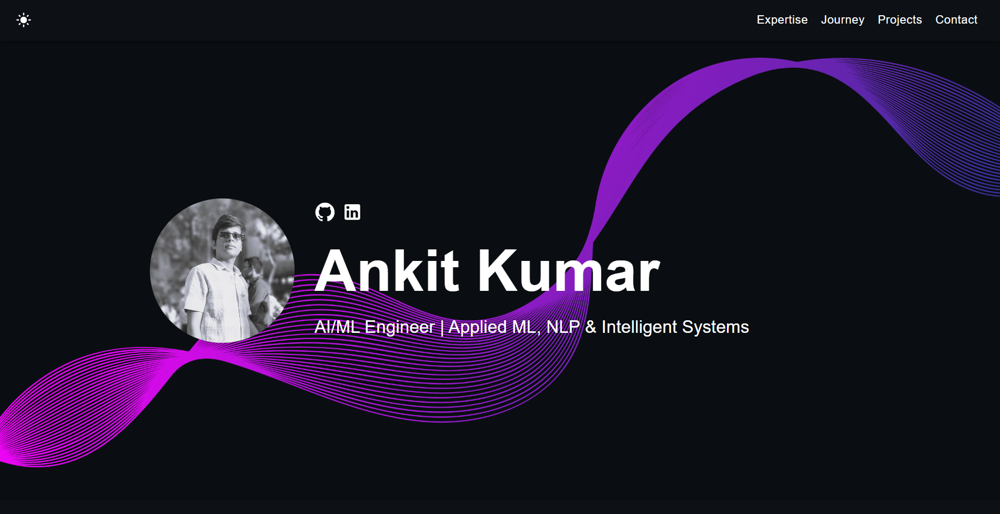

# Ankit Kumar Portfolio 🚀

      

## What is this?

This is my personal developer portfolio website designed to showcase my projects, technical journey, skills, and experience in AI/ML, NLP, data analytics, and software development.

View the [Live Portfolio](https://myportfolio-orpin-tau.vercel.app/).

This portfolio highlights my work through project showcases, technical sections, and a clean interactive layout built for recruiters, collaborators, and learning opportunities.



## Features

✅ Personal developer portfolio  
✅ Responsive design & mobile-friendly  
✅ Supports both dark and light modes  
✅ Showcases projects, journey, skills, and contact details  
✅ Built with modern technologies (React, TypeScript, JavaScript, and SCSS)  

## Quick Setup

1. Ensure you have [Node.js](https://nodejs.org/) installed. Check your installation by running:

    ```bash
    node -v
    ```

2. In the project directory, install dependencies:

    ```bash
    npm install
    ```

3. Start the development server:

    ```bash
    npm start
    ```

4. Open [http://localhost:3000](http://localhost:3000) to view the app in the browser.

5. Customize the portfolio by navigating to the `/src/components` directory and updating text, images, links, and other content as needed.

The page will reload if you make edits, and you will see any lint errors in the console.

## Featured Projects

### 🧠 Speech Emotion Recognition
A machine learning project focused on recognizing emotions from speech signals using extracted audio features such as MFCC, Mel Spectrogram, and Chroma.  
Compared multiple classical ML models and evaluated performance using structured experimentation and confusion-matrix-based analysis.

### 🤖 HackBot AI
A RAG-based Discord assistant built for hackathon communities using LLaMA 3.1 via Groq API, FAISS, and sentence-transformers.  
Supports semantic retrieval, file-based knowledge ingestion, and modular intelligent Q&A workflows.

### 🏅 OlympicX
An interactive Olympic analytics platform built with Python, Pandas, Streamlit, and EDA.  
Used to explore medal trends, country comparisons, athlete participation, and historical Olympic insights through dynamic filtering and visual analytics.

### 📧 Email Spam Classifier
An end-to-end spam classification system using TF-IDF and Logistic Regression with both Streamlit and FastAPI deployment.  
Built with a precision-focused pipeline and multiple ML model comparisons for robust spam detection.

## Deployment

You can choose your preferred service (e.g., [Vercel](https://vercel.com/), [Netlify](https://www.netlify.com/), [Render](https://render.com/)) for deployment. One of the easiest ways to host this portfolio is using Vercel. Follow the instructions below for a production deploy.

1. **Set Up GitHub Repository**

    Push your portfolio code to a GitHub repository.

2. **Connect to Vercel**

    Go to [Vercel](https://vercel.com/) and import your GitHub repository.

3. **Deploy the App**

    Vercel will automatically detect the React app settings. Click deploy.

4. **Access Your Deployed App**

    After successfully deploying, you can access your app using your Vercel deployment link.
